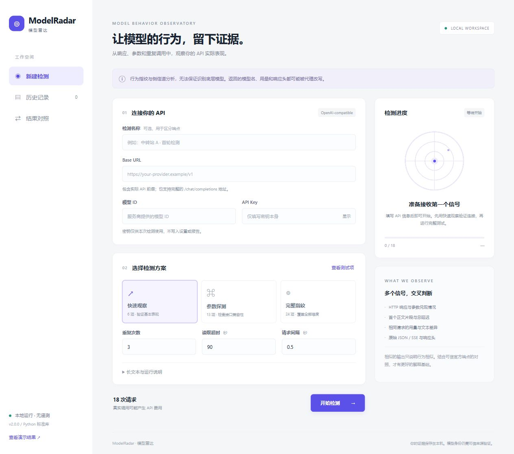

# ModelRadar · 模型雷达

**让模型的行为，留下证据。**

一款在本机运行的 OpenAI-compatible API 检测工具。通过中文界面采集响应、参数兼容性、重复稳定性和用量差异，并保留可复核的原始证据。

> ModelRadar 做的是行为指纹与侧信道分析，无法保证识别底层模型。它不提供模型身份概率，也不把服务端自报的 model 当作身份凭证。



## 开始使用

需要 Python **3.10+**，无需安装任何第三方依赖。

```console
python app.py
```

Windows 可双击 `start.bat`，或运行 `py -3 app.py`。macOS / Linux 通常使用 `python3 app.py`。本地服务仅监听 `127.0.0.1`，自动选择可用端口，并在默认浏览器打开界面。保持启动窗口运行，按 Ctrl+C 退出。可用 `--port 8765 --no-browser` 固定端口或不自动打开浏览器。

填写 Base URL、模型 ID 和 API Key，选择方案后点击“开始检测”。Base URL 应包括 API 前缀，例如 `https://your-provider.example/v1`；脚本只追加 `/chat/completions`。密钥只填本身，无需添加 `Bearer`。默认快速观察为 **6 项 × 3 次 = 18 次请求**；完整方案为 **24 项 × 3 次 = 72 次请求**。真实请求会产生服务商费用。

## 功能

- 中文响应式界面：连接配置、测试项选择、请求数量预览和实时进度。
- 快速观察、参数探测、完整指纹三种方案，支持自定义测试项、重复次数、超时、间隔与长文本长度。
- 保存原始 JSON / SSE、HTTP headers、model、response ID、system_fingerprint、完整 usage 和结束原因。
- 客户端 TTFT、总延迟、精确输出检查、重复文本统计。
- 自动标记同一请求体的输入计数变化、stop 未截断、概率数据缺失。标记是观察，不是换模判决。
- 历史记录、逐次证据查看、报告预览和 JSONL / CSV / Markdown / 原始正文 ZIP 导出。
- 导入旧版 `results.jsonl`，按 2.0 精确字符规则重新检查固定答案。导入的文件路径不会被执行或读取。
- 两批结果对照，显示语料哈希是否一致。可以比较中转站与官方端点，或不同时段的检测。
- 内置虚构演示结果，不需要密钥，不发起 API 请求。
- 原命令行工具保留：`python collector.py --help`。

## 数据与密钥

检测数据默认写入项目的 `data/<run_id>/`，也可通过 `python app.py --data-dir <directory>` 指定目录。历史文件和密钥不应提交到 Git；项目已忽略 `data/`、`.env` 和本地缓存。

UI 密钥仅在页面输入框和当前运行的内存中使用，提交成功后清空输入框。不存 localStorage，不读取已有 OPENAI_API_KEY，不写配置或报告。退出后不会记住密钥。UI 没有在线账户、遥测、CDN 或第三方脚本；请求仅发送到你填写的 API 地址。Python 遵循系统代理配置，因此代理仍可能参与网络通信。

响应体保存为客户端读取的原始字节，精确匹配当前 API key 的片段会脱敏。敏感响应头（cookie、authorization、token、secret 等）会脱敏。未知或编码后的秘密可能无法识别，导出分享前请检查。导入旧 JSONL 时只保留证据字段并丢弃 headers、request 和 raw_file；未知藏在正文里的秘密仍需要人工检查。

本地控制接口检查 Host、Origin 和每次启动的会话 token，不提供跨域访问。只用于个人本机使用，不应通过反向代理暴露到公网。TLS 校验启用，不跟随上游重定向；非本机 API 必须 HTTPS。

## 如何理解结果

- HTTP 200 表示服务端接受了请求，不等于所有参数生效。logprobs 缺失、stop 未兑现需单独核对。
- 固定答案从 2.0 起精确比较，前后空格也计为未通过；UI 同时保留去除首尾空白后的文本差异计数。JSON 项目检查简单的 `{"x":7}` 对象，不能证明服务端实施了硬 schema 约束。
- TTFT 从请求开始到首个非空 `delta.content`，包含网络、排队与缓冲；role、推理和工具字段不计入。非 SSE 响应没有流式 TTFT。
- 用量、缓存字段、response ID、模型名均可能由代理转换。相同请求的 token 差异可能来自隐藏上下文、统计口径、适配器或路由；单个线索无法确认模型身份。
- 代码生成与中文改写、英文写作需要人工检查。应用不执行模型生成的代码。
- `complete` 是协议完整性，不代表正确答案，length 结束或拒答仍需检查 finish_reasons。
- UI 延迟中位数只计算完整响应；Markdown 明细的延迟中位数包括有延迟记录的失败调用，请注意口径。
- 401/403 自动停止。429、502、超时等会记录并继续，无自动重试或参数回退。
- 停止会等待当前请求结束，之后不发起新请求。读取超时是每次 socket 操作的超时，并非整体硬截止；持续输出的流可能等待更久。退出进程时正在执行的请求可能无法完整落盘。
- 提示词通常要求短回答，但没有给所有请求加统一输出上限，因为上限参数本身在被测。请求次数预览不等于费用上限。
- 相同语料哈希只是可比性的一个条件；还需要相同采样配置、时间、区域和负载。三次重复只能初筛，简单题不能区分高级模型。

## 命令行与开发

```console
python collector.py --list
python collector.py --dry-run
python collector.py --base-url https://your-provider.example/v1 --model YOUR_MODEL --prompt-key
python -m unittest discover -s tests -v
```

项目采用 Python 标准库 HTTP 服务与原生 HTML / CSS / JavaScript。无构建步骤，可离线打开 UI；实际检测需要访问所填 API。测试使用本地模拟服务，不消耗真实 API 费用。GitHub Actions 在 Windows、macOS、Linux 的 Python 3.10 / 3.13 上运行相同测试。

接口参考：[OpenAI Chat Completions](https://developers.openai.com/api/reference/resources/chat/subresources/completions/methods/create)、[SSE 事件](https://developers.openai.com/api/reference/resources/chat/subresources/completions/streaming-events)。兼容服务不一定实现全部协议。

## 项目结构

```text
app.py              本地服务、任务运行、导入导出与观察汇总
collector.py        原始 API 采集与 CLI
web/                中文 UI，不依赖在线资源
tests/              模拟 API 和本地安全边界测试
data/               个人检测数据（Git 忽略）
```

MIT License。欢迎提交可复现的接口问题或改进建议；请移除密钥及敏感内容后再分享日志。
